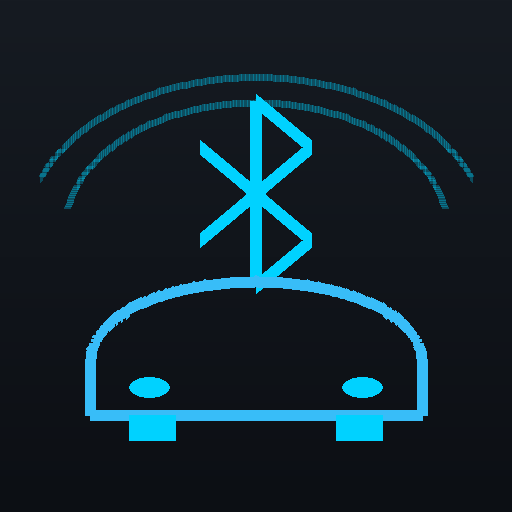

# Mediablue - A2DP Sink & HFP Web Client



Ubuntu、BlueZ、Audioctl (PipeWire / WirePlumber / PulseAudio) との連携を前提とした、**A2DP Sink（オーディオ受信）** および **HFP（ハンズフリー通話）** に対応した車載向けWebクライアントアプリケーションです。

バックエンドにはPHPを採用し、Dockerコンテナとして容易にビルド・起動できます。実機ハードウェア連携モードに加え、Bluetooth機器がない開発環境でも全UI・機能をテストできる**シミュレーション（モック）モード**を標準搭載しています。

---

## 🌟 主な機能

- **🎵 A2DP Sink & AVRCP メディアプレーヤー**
  - スマートフォンからBluetooth経由で高音質オーディオストリーミング受信（AAC / SBC / LDAC / aptX）
  - AVRCPによるリアルタイム楽曲メタデータ取得（曲名、アーティスト、アルバム、再生時間）
  - 再生 / 一時停止 / 次へ / 前へ / シーク操作
  - ビニールレコード回転アニメーション付きの車載ダークUI
- **📞 HFP (Hands-Free Profile) ハンズフリー電話**
  - 車載マイクとスピーカーを用いたハンズフリー通話
  - 着信時の大画面ポップアップ通知（応答 / 拒否）
  - タッチ対応テンキーダイヤラーによる発信
  - 通話時間タイマー、マイクミュート、終話コントロール
  - スマートフォンのバッテリー残量および電波強度（アンテナピクト）のリアルタイム表示
- **📶 BlueZ Bluetooth 管理**
  - Bluetoothアダプタの電源（Power）および検出可能（Discoverable）モードの切替
  - 周辺デバイスのリアルタイムスキャン & ワンクリックペアリング / 信頼（Trust）設定
  - プロファイル状態の可視化（A2DP Source, AVRCP, HFP-AG）
- **🎚️ Audioctl & オーディオミキサー (PipeWire / PulseAudio)**
  - マスター音量調整およびミュート
  - 出力デバイス（HDMI、3.5mmジャック、USB DACなど）の動的切替
  - マイク入力ゲイン設定
- **🚘 車載インフォテインメントUI**
  - タッチパネル操作に最適化された大型ボタン & ハイコントラスト・ダークテーマ
  - レスポンシブ設計（車載ワイド液晶、タブレット、スマートフォン、PCブラウザに対応）
- **📱 PWA (Progressive Web App) 完全対応**
  - 車載ディスプレイやタブレット、スマートフォンに「ホーム画面に追加」するだけで、アドレスバーのないスタンドアロン車載アプリとしてフルスクリーン起動
  - Service Worker によるUIシェルのオフライン事前キャッシュで瞬時に起動
  - ホーム画面アイコン長押しによるアプリ内ショートカット（Media, Phone, Bluetooth）対応

---

## 🏗️ システムアーキテクチャ

```
+-------------------------------------------------------------+
|                      Smartphone (iOS / Android)              |
|   A2DP Source (Music)  /  AVRCP  /  HFP-AG (Phone Call)     |
+------------------------------+------------------------------+
                               | Bluetooth (RFCOMM / L2CAP)
+------------------------------v------------------------------+
|                    Ubuntu Host Machine                       |
|                                                             |
|   [BlueZ 5.x]               [PipeWire / WirePlumber]        |
|    - bluetoothd              - A2DP Sink endpoint           |
|    - D-Bus System Bus        - HFP-HF endpoint              |
|    - /var/run/dbus           - /run/user/1000/pulse         |
+------------------------------+------------------------------+
                               | Mounts (D-Bus & Audio Socket)
+------------------------------v------------------------------+
|                  Docker Container (mediablue)                |
|                                                             |
|   [PHP 8.2 Backend]                                         |
|    - BluezService (bluetoothctl CLI & D-Bus)                |
|    - AudioService (pactl / wpctl Audioctl)                  |
|    - MediaService (AVRCP / playerctl)                       |
|    - TelephonyService (HFP Call Manager)                    |
|    - REST API Endpoints (/api/...)                          |
|                                                             |
|   [Web Frontend] (Apache mod_rewrite)                       |
|    - Automotive Touch UI (HTML5 / CSS3 / Vanilla JS)        |
+------------------------------+------------------------------+
                               | HTTP (Port 12080)
+------------------------------v------------------------------+
|               Web Browser (Car Display / Client)             |
+-------------------------------------------------------------+
```

---

## 📋 前提条件（Ubuntu ホスト環境）

- **OS**: Ubuntu 22.04 LTS または Ubuntu 24.04 LTS 推奨
- **Bluetooth**: Bluetooth 4.0以降対応のUSBドングルまたは内蔵Bluetoothチップ
- **オーディオサーバー**:
  - Ubuntu 22.04 / 24.04 標準の **PipeWire + WirePlumber**（推奨）
  - または **PulseAudio (pulseaudio-module-bluetooth)**
- **Docker & Docker Compose**: Docker Engine 20.10+ / Docker Compose v2+

---

## ⚙️ ホストOS（Ubuntu）の事前設定

### 1. 必要なパッケージのインストール

```bash
sudo apt update
sudo apt install -y bluez bluez-tools pipewire-audio-client-libraries wireplumber libspa-0.2-bluetooth
```

### 2. BlueZ の A2DP Sink / HFP 有効化

`/etc/bluetooth/main.conf` を編集します：

```ini
[General]
Name = Ubuntu mediablue
# 車載ハンズフリー・オーディオデバイスとしてのクラス指定 (0x200420)
Class = 0x200420
DiscoverableTimeout = 0
PairableTimeout = 0
MultiProfile = multiple
FastConnectable = true

[Policy]
AutoEnable = true
```

設定反映のため、Bluetoothサービスを再起動します：

```bash
sudo systemctl restart bluetooth
```

### 3. PipeWire / WirePlumber の Bluetooth プロファイル設定

WirePlumber では、標準で A2DP Sink および HFP-HF (Hands-Free) が有効化されています。念のため設定を確認・有効化します：

```bash
# 現在のPipeWire Bluetoothノード状態確認
wpctl status
```

---

## 🚀 立ち上げ方（Dockerコンテナの起動）

### パターンA: Ubuntu実機・ホスト連携モード（本番）

ホストのD-BusソケットおよびPulseAudio/PipeWireソケットをマウントし、ホストのBluetoothハードウェアを直接制御します。

1. **リポジトリをクローンまたは配置**:

   ```bash
   cd mediablue
   ```

2. **UIDの確認と調整**:
   ホストの実行ユーザーID（通常 `1000`）に合わせて、必要に応じて `docker-compose.yml` の `/run/user/1000` をホストの実際のUIDに合わせてください（`id -u` で確認可能）。

3. **コンテナのビルドと起動**:

   ```bash
   docker compose up -d --build
   ```

4. **ブラウザでアクセス**:
   - 車載端末またはネットワーク内のブラウザから `http://<ホストのIPアドレス>:12080/` にアクセスします。
   - `network_mode: "host"` のため、ホストのポート12080で直接リッスンします（ポート80の既存Webサーバー等と競合しません）。

---

### パターンB: シミュレーション（開発・デモ）モード

BluetoothハードウェアがないPC（Windows、macOS、テスト環境）でUIや操作感を試す場合は、モックモード用Composeファイルを使用します。

```bash
# 開発・シミュレーションモードで起動
docker compose -f docker-compose.dev.yml up -d --build
```

ブラウザで以下にアクセスします：
👉 **`http://localhost:12080/`**

> **💡 シミュレーションモードの特徴:**
>
> - 仮想のスマートフォン（iPhone 15 Pro、Pixel 8等）が初期登録されています。
> - 周辺スキャンで新しい端末が検出され、ペアリングや接続が体験できます。
> - 音楽再生（A2DP）では曲メタデータや再生位置がリアルタイムに進行します。
> - **「Settings」タブの「📞 Trigger Incoming Call」ボタン**を押すと、模擬着信イベントが発生し、着信モーダルの応答や通話テストが即座に確認できます。

---

## 📱 画面と使い方

### 1. メディアプレーヤー (Media Player)

- スマートフォンからSpotify、Apple Music、YouTubeなどの音楽を再生すると、曲名・アーティスト名・アルバム名が自動的に反映されます。
- 画面中央のボタンで **再生 / 一時停止 / スキップ** のAVRCP制御が可能です。
- 再生中はビニールレコードが回転し、下部のシークバーが進みます。

### 2. ハンズフリー電話 (Hands-Free Phone)

- **待機中**: 接続中のスマートフォンのキャリア名、バッテリー残量、電波状況が表示されます。
- **着信時**: 画面全体に着信モーダルが表示され、発信者名と番号を確認して「Answer (応答)」または「Decline (拒否)」を選択できます。
- **通話中**: 通話時間カウンターが作動し、マイクミュートや終話ボタンが利用できます。
- **発信**: 右側のタッチテンキーで電話番号を入力し、緑色の発信ボタンで通話を開始できます。

### 3. Bluetooth 設定 (Bluetooth Manager)

- **Power / Discoverable**: スイッチをONにすることで、スマートフォン側のBluetooth設定画面から本機（`Ubuntu mediablue`）が検出できるようになります。
- **Scan for Devices**: 周辺のBluetoothデバイスを検索します。
- **Pair & Trust**: 検出されたデバイスをワンクリックでペアリング・自動信頼します。
- **Connect / Disconnect**: A2DPおよびHFPプロファイルを接続・切断します。

### 4. オーディオミキサー (Audio Mixer)

- **Master Volume**: 車載スピーカーの全体音量をスライダーで直感的に調整できます。
- **Output Devices (Sinks)**: PulseAudio / PipeWire で検出された出力先（内蔵スピーカー、USB DAC、HDMI等）をワンタップで切り替え可能です。

### 5. PWA (ネイティブ風スタンドアロンアプリ) としてのインストール

車載タブレットやスマートフォンのホーム画面に追加することで、ブラウザのアドレスバーやナビゲーションボタンが非表示になり、車載専用アプリのように全画面で起動できます。

- **Google Chrome / Chromium / Edge (Android / PC / Raspberry Pi)**:
  - 画面上部の **「📲 Install App」** ボタンをタップ、またはブラウザメニューから「アプリをインストール」/「ホーム画面に追加」を選択します。
- **Safari (iPhone / iPad)**:
  - 共有ボタン（四角から矢印が出ているアイコン）をタップし、**「ホーム画面に追加」** を選択します。
- **オフライン起動 & キャッシュ管理**:
  - Service Worker により、ネットワークが不安定な起動直後でも瞬時にUIが立ち上がります。
  - キャッシュの更新は「Settings」タブの **「🧹 Clear Cache」** ボタンからワンクリックで行えます。

---

## 🔌 REST API エンドポイント仕様

すべてのAPIはJSON形式でやり取りされます。

| メソッド | エンドポイント                 | 説明                                           |
| -------- | ------------------------------ | ---------------------------------------------- | -------- | ------ | --------- |
| `GET`    | `/api/bluetooth/status`        | Bluetoothアダプタ状態・接続中デバイス取得      |
| `GET`    | `/api/bluetooth/devices`       | ペアリング済みおよび検出デバイス一覧           |
| `POST`   | `/api/bluetooth/scan`          | 周辺デバイスのスキャン開始                     |
| `POST`   | `/api/bluetooth/scan/stop`     | スキャン停止                                   |
| `POST`   | `/api/bluetooth/pair`          | ペアリング (`{"mac": "XX:XX:..."}`)            |
| `POST`   | `/api/bluetooth/connect`       | 接続 (`{"mac": "XX:XX:..."}`)                  |
| `POST`   | `/api/bluetooth/disconnect`    | 切断 (`{"mac": "XX:XX:..."}`)                  |
| `POST`   | `/api/bluetooth/remove`        | デバイス登録解除 (`{"mac": "XX:XX:..."}`)      |
| `POST`   | `/api/bluetooth/power`         | アダプタ電源ON/OFF (`{"power": true}`)         |
| `POST`   | `/api/bluetooth/discoverable`  | 検出可能モード切替 (`{"discoverable": true}`)  |
| `GET`    | `/api/media/player`            | A2DP再生ステータス・メタデータ取得             |
| `POST`   | `/api/media/control`           | AVRCP制御 (`{"action": "play"                  | "pause"  | "next" | "prev"}`) |
| `GET`    | `/api/telephony/status`        | HFP通話状態・バッテリー・電波状況取得          |
| `POST`   | `/api/telephony/answer`        | 通話受話                                       |
| `POST`   | `/api/telephony/hangup`        | 通話終了 / 拒否                                |
| `POST`   | `/api/telephony/dial`          | 番号発信 (`{"number": "09012345678"}`)         |
| `POST`   | `/api/telephony/test-incoming` | (モック) 着信シミュレーション開始              |
| `GET`    | `/api/audio/status`            | 音量・Sinks・Sources一覧取得                   |
| `POST`   | `/api/audio/volume`            | マスター音量設定 (`{"volume": 80}`)            |
| `POST`   | `/api/audio/mute`              | ミュート設定 (`{"mute": true}`)                |
| `POST`   | `/api/audio/sink`              | デフォルト出力先切替 (`{"sink": "sink_name"}`) |
| `GET`    | `/api/system/info`             | システム診断情報・D-Bus接続確認                |
| `POST`   | `/api/system/mode`             | 動作モード切替 (`{"mock": true                 | false}`) |

---

## 🛠️ トラブルシューティング

### Q1. スマホのBluetooth設定画面に本機が表示されない

- Bluetoothタブで **「Discoverable」がON** になっているか確認してください。
- ホスト側で `bluetoothctl discoverable on` が正常に通るか確認してください。
- 別のデバイスと既にペアリング済みの場合は、一度既存の接続を切断してください。

### Q2. 接続できているがスピーカーから音が出ない

- ホストのユーザーが `audio` グループに所属しているか確認してください：
  ```bash
  sudo usermod -aG audio,bluetooth $USER
  ```
- 「Audio」タブを開き、出力先デバイス（Sink）が正しく選択されているか、マスター音量が0またはミュートになっていないか確認してください。
- ホスト端末側で `pactl list sinks` を実行し、A2DP Sinkストリームがアクティブになっているか確認してください。

### Q3. コンテナログで `Failed to connect to system bus` と出る

- ホストのD-Busソケットがマウントされているか確認してください（`docker-compose.yml` 内の `/var/run/dbus:/var/run/dbus`）。
- Ubuntuホストで `systemctl status dbus` がアクティブであることを確認してください。

### Q4. 「AVRCP control failed」エラーが出る

- **スマートフォン側で音楽アプリ（Spotify, Apple Music, YouTube等）が起動して曲が再生待機状態になっているか確認してください**:
  - スマートフォンが接続されていても、スマホ側で一度も音楽アプリが起動していない場合、BlueZの `MediaPlayer1` オブジェクトが生成されずAVRCPコマンドを受け付けない場合があります。
- **「Settings」タブの「BlueZ MediaPlayer1 (AVRCP)」を確認してください**:
  - `Found (/org/bluez/hci0/dev_.../player0) ✅` と表示されていれば、D-Bus直通でAVRCP制御（Play/Pause/Next/Prev）が可能です。
- **D-Busソケットの書き込み権限**:
  - `docker-compose.yml` で `/var/run/dbus:/var/run/dbus`（読み書き可能）でマウントされているか確認してください。

---

## 📄 ライセンス

MIT License
